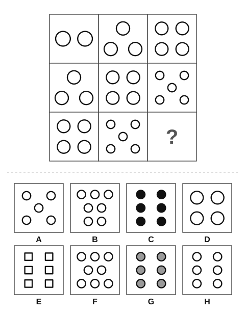
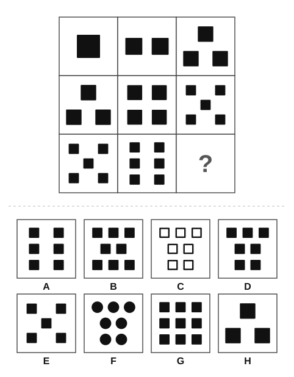
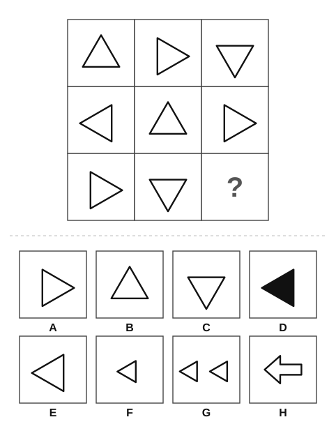
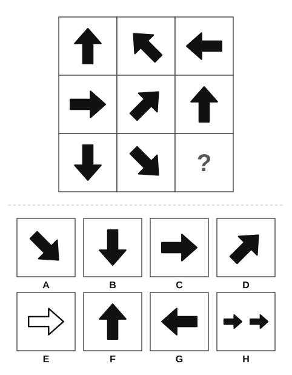
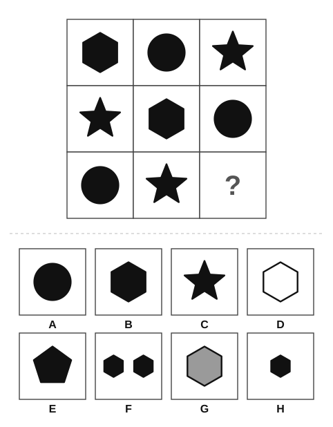
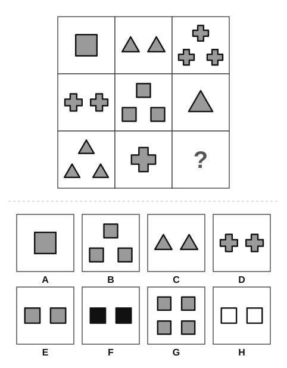
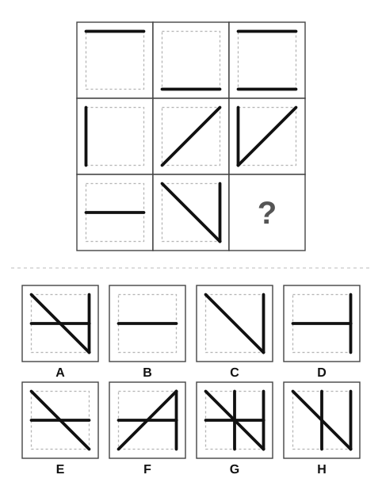
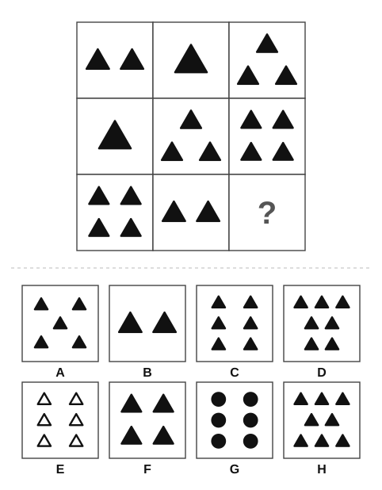
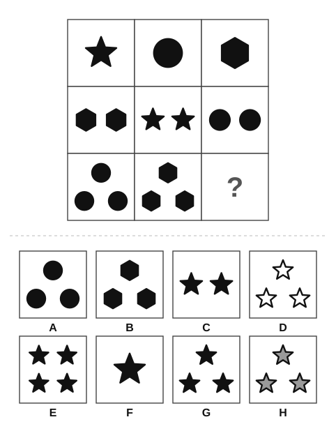
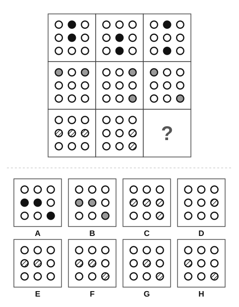

<!-- nav:top -->
[Contents](../README.md#contents) · Previous: [Raven's Progressive Matrices explained](test-overview.md) · Next: [Progression](sections/progression.md)
<!-- /nav:top -->

# 15-minute diagnostic

Ten original items, two for each rule family, roughly in the order the guides teach them. Set a timer for 15 minutes, write down your answers (A to H), and only then open the explanations. The table at the end tells you where to start studying.

Each item is a 3 by 3 matrix with the bottom-right cell missing. Choose the option that completes it.

## Part A: Progression

<!-- items:0:start -->

### Item 1

Answer and explanation, item 1

**Answer: H.** Progression. Each step to the right adds one circle and each row starts one higher: 4, 5, so the gap has **six white circles**.

*Why not the others:* Option A has five, a copy of the cell before.

### Item 2

Answer and explanation, item 2

**Answer: D.** Progression. Across each row the count rises by one; down each column it rises by two. Row 3 runs 5, 6, so the gap has **seven black squares**.

*Why not the others:* Option A has six, a copy of the cell before.

<!-- items:0:end -->

## Part B: Rotation and movement

<!-- items:1:start -->

### Item 3

Answer and explanation, item 3

**Answer: E.** Rotation. Within each row the triangle turns a quarter turn clockwise per step. Row 3 points right, then down, so the gap points **left**.

*Why not the others:* Option A points right, which is no turn from the start of the row and two turns back from the cell before.

### Item 4

Answer and explanation, item 4

**Answer: C.** Rotation. The arrow turns 45 degrees **anticlockwise** per step. Row 3 points down, then down-right, so next it points **right**.

*Why not the others:* Option A points down-right, a copy of the cell before. Option B points down, the start of the row.

<!-- items:1:end -->

## Part C: Distribution of three

<!-- items:2:start -->

### Item 5

Answer and explanation, item 5

**Answer: B.** Distribution of three. Each row has a hexagon, a circle and a star once. Row 3 has a circle and a star, so the gap is **a black hexagon**.

*Why not the others:* Option A and Option C repeat shapes row 3 already has.

### Item 6

Answer and explanation, item 6

**Answer: E.** Distribution of three, twice. Counts in row 3: three and one, so two. Shapes: triangle and cross, so square. The answer is **two grey squares**.

*Why not the others:* Option B has squares but three of them, a count row 3 already has.

<!-- items:2:end -->

## Part D: Addition and subtraction

<!-- items:3:start -->

### Item 7

Answer and explanation, item 7

**Answer: A.** Addition. The third cell is the first two laid on top of each other, so the gap has **the horizontal middle line, the vertical middle line and the diagonal from top left to bottom right**.

*Why not the others:* Option D drops the diagonal. Option F uses the other diagonal.

### Item 8

Answer and explanation, item 8

**Answer: C.** Addition. The third cell's count is the first two added: 4 + 2 = **six black triangles**.

*Why not the others:* Option A has five and Option D has seven: off by one in each direction.

<!-- items:3:end -->

## Part E: Combined rules

<!-- items:4:start -->

### Item 9

Answer and explanation, item 9

**Answer: G.** Combined. The row sets the count (one, two, three) and the shape follows a distribution of three. Row 3 has circles and hexagons, so the gap is **three black stars**.

*Why not the others:* Option A has three but circles, already in row 3.

### Item 10

Answer and explanation, item 10

**Answer: F.** Combined. Shared dots cancel, and the row sets the shading (black, grey, striped). Row 3 shares the middle-right dot, so the gap keeps **middle left, centre and bottom right, striped**.

*Why not the others:* Option B has the right dots but grey, the row 2 shading.

<!-- items:4:end -->

## What your result means

<!-- key:start -->

| Item | 1 | 2 | 3 | 4 | 5 | 6 | 7 | 8 | 9 | 10 |
|---|---|---|---|---|---|---|---|---|---|---|
| Answer | H | D | E | C | B | E | A | C | G | F |

<!-- key:end -->

Score each part out of 2.

| Part | Rule family | If you scored 0 | If you scored 1 | If you scored 2 |
|---|---|---|---|---|
| A, items 1 and 2 | Progression | Start with the [progression guide](sections/progression.md) | Do its traps list and items | Skim it later |
| B, items 3 and 4 | Rotation and movement | Start with the [rotation guide](sections/rotation.md) | Do its traps list and items | Skim it later |
| C, items 5 and 6 | Distribution of three | Start with the [distribution guide](sections/distribution.md) | Do its traps list and items | Skim it later |
| D, items 7 and 8 | Addition and subtraction | Start with the [addition and subtraction guide](sections/overlay.md) | Do its traps list and items | Skim it later |
| E, items 9 and 10 | Combined rules | Fix your weakest single rule first, then the [combined guide](sections/combined.md) | Go straight to the combined guide | You are ready for timed practice |

**Overall:** 9 to 10 means your rule-spotting is strong and your next gain is speed; go to the [timing guide](timing.md). 6 to 8 is a solid base with one or two weak families. 5 or fewer means work through the guides in order, starting with progression.

These items are easier than the hardest items on APM-III, so treat a high score here as a good start, not a guarantee. For a fuller picture, take the [free 23-puzzle Raven's practice test on PrepClubs](https://prepclubs.com/free-practice-tests/ravens-progressive-matrices?utm_source=github&utm_medium=referral&utm_campaign=7acab2&utm_content=ravens-progressive-matrices) under real timing.

---

<!-- nav:bottom -->
← Previous: [Raven's Progressive Matrices explained](test-overview.md) | Next: [Progression](sections/progression.md) → | [Back to contents](../README.md#contents)
<!-- /nav:bottom -->
