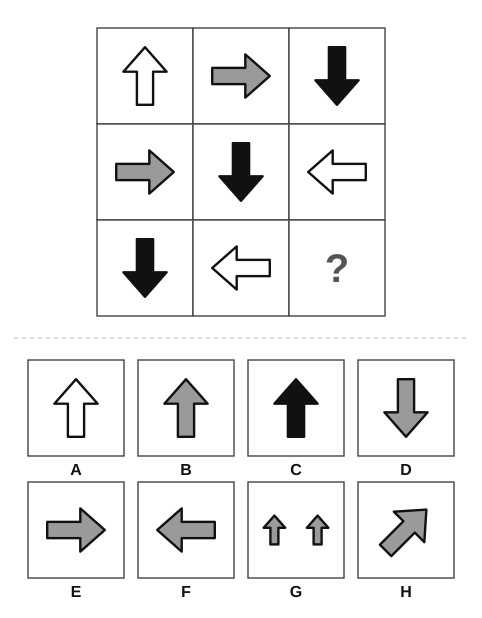
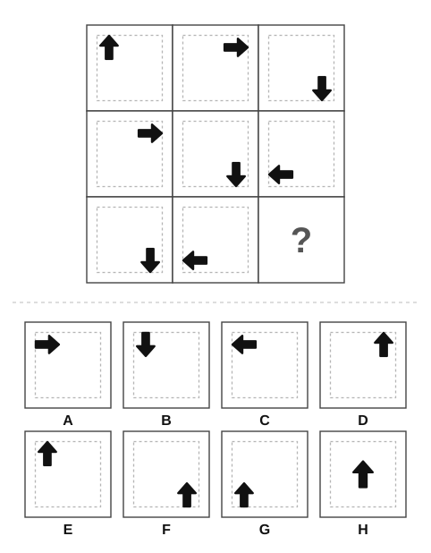

<!-- nav:top -->
[Contents](../../README.md#contents) · Previous: [Addition and subtraction](overlay.md) · Next: [How scoring works](../scoring.md)
<!-- /nav:top -->

# Combined rules

**In one line:** two or three rules run at once, each controlling a different feature, and you solve each rule on its own before putting the answer together.

The hardest Raven's items are rarely built on a new kind of rule. They are built by stacking the rules from the other four guides: a count that progresses while a shape is distributed, or an arrow that turns while it moves. The skill is separating them.

## What it measures

Can you hold several patterns in mind, keep them apart and combine them into one answer? It is the same skill as the other rule families, plus discipline.

## How the questions look

| Combination | Example | How to split it |
|---|---|---|
| Progression + distribution | Count rises across columns; shapes shuffle across rows | Solve count, then shape |
| Rotation + distribution | Arrow turns; shading shuffles | Solve direction, then shading |
| Overlay + row feature | Dots cancel; shading set by row | Build the dot pattern, then colour it |
| Movement + rotation | Arrow moves round the corners and turns at each step | Track position, then direction |
| Three rules | Size grows, shading set by row, shape distributed | One feature at a time |

## A method that works

1. **List every feature that varies** anywhere in the grid: shape, count, size, shading, direction, position, inner parts.
2. **Solve each feature alone,** using the method for its rule family. Write one short answer per feature: "square", "three", "black".
3. **Ask whether a feature is set by the row, by the column, or by a rule along the row.** Row-set and column-set features are the easiest to read.
4. **Combine the answers** into one description of the missing cell.
5. **Eliminate options feature by feature.** With three features, most options fail at least one. You should be left with exactly one.
6. **If two options survive,** you have missed a feature. Look for what differs between them and solve that feature.

## Traps that cost points

- **Stopping after one rule.** The option that satisfies the first rule you found and breaks a second one is always there.
- **Letting features blur together.** "Bigger and darker" can be two separate rules on different directions of the grid. Keep them apart.
- **Doing everything in your head.** On a three-rule item, write a feature list on scrap paper if you are allowed it.
- **Over-reading.** Not every difference is a rule. If something is the same in every cell, ignore it.
- **Spending too long.** A combined item is worth the same as an easy one. If the third feature will not resolve after two minutes, eliminate what you can and choose.

## Timing

Expect to spend most of your time on these. On APM-III, finishing easier items in under a minute leaves room for two to three minutes on a hard combined item. On Raven's Adaptive, harder items appear when you are answering well, so a run of difficult combined items is a good sign, not a bad one.

## Practice items

These 2 items are original, drawn for these notes. They are not taken from any Raven's test or publisher's materials. Each one is a 3 by 3 matrix with the bottom-right cell missing; choose the option, A to H, that completes it.

<!-- items:start -->

### Item 1

Answer and explanation, item 1

**Answer: B.** Two rules. The arrow turns a quarter turn clockwise per step, each row starting a quarter turn on. The shading is a distribution of three: white, grey and black once per row. Row 3 goes down-black, left-white, so the gap is **a grey arrow pointing up**.

*Why not the others:* Option A points up but is white, already used in row 3. Option D is grey but points down, half a turn off.

### Item 2

Answer and explanation, item 2

**Answer: E.** The arrow does two things at each step: it moves one corner clockwise and it turns a quarter turn clockwise. Row 3 has it bottom right pointing down, then bottom left pointing left. Next it moves to **the top-left corner and points up**.

*Why not the others:* Option A is in the right corner but still points right, so it skipped the turn. Option D points up but is in the top-right corner, so it skipped the move.

<!-- items:end -->

Want more? The [free timed Raven's practice test on PrepClubs](https://prepclubs.com/free-practice-tests/ravens-progressive-matrices?utm_source=github&utm_medium=referral&utm_campaign=7acab2&utm_content=ravens-progressive-matrices) has the full 23 puzzles, every answer explained.

## Score yourself

<!-- key:start -->

| Item | 1 | 2 |
|---|---|---|
| Answer | B | E |

<!-- key:end -->

- **2 of 2:** you are ready for a full timed run. Read the [timing guide](../timing.md) next.
- **1 of 2:** check each miss for the feature you did not solve. It is usually the second or third rule.
- **0 of 2:** go back to the guide for the rule family you missed most often, then retry these items in a week.

## Next step

Combined items are the ones that separate scores. Put the whole method under real time pressure with the [free Raven's practice test on PrepClubs](https://prepclubs.com/free-practice-tests/ravens-progressive-matrices?utm_source=github&utm_medium=referral&utm_campaign=7acab2&utm_content=ravens-progressive-matrices).

---

<!-- nav:bottom -->
← Previous: [Addition and subtraction](overlay.md) | Next: [How scoring works](../scoring.md) → | [Back to contents](../../README.md#contents)
<!-- /nav:bottom -->
