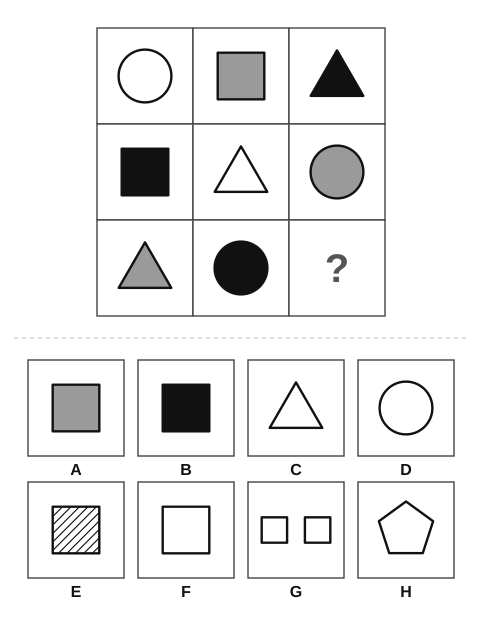
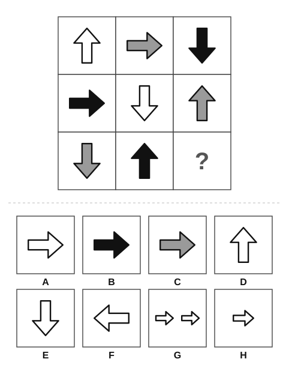

<!-- nav:top -->
[Contents](../../README.md#contents) · Previous: [Rotation and movement](rotation.md) · Next: [Addition and subtraction](overlay.md)
<!-- /nav:top -->

# Distribution of three

**In one line:** each row contains the same three values, such as a circle, a square and a triangle, once each in a different order, and the gap holds whichever value its row is missing.

This rule is the one people most often fail to see, because nothing "changes" from left to right in a way that looks like a sequence. The values are simply shuffled. Once you know to look for it, it becomes one of the most reliable rules on the test.

## What it measures

Can you notice that a set of values repeats across rows in different arrangements, and work out which one is missing? It is like a Sudoku row with three boxes: each value appears once.

## How the questions look

| Form | What you see | What to check |
|---|---|---|
| One feature | Circle, square, triangle in each row, shuffled | Which shape is missing from the gap's row? |
| Two features | Shapes shuffled one way, shading shuffled another | Solve shape and shading separately |
| Counts | One, two and three of something in each row | Count is the distributed value, not a progression |
| Parts | Outer shape and inner shape each shuffled | Treat outer and inner as two puzzles |
| Positions | Left, centre and right once each | Position is just another value |

A useful tell: if the three values in row 1 also appear in rows 2 and 3, just in a different order, it is almost certainly a distribution of three.

## A method that works

1. **List the values in row 1** for one feature, such as shape: circle, square, triangle.
2. **Check rows 2 and 3 use the same set.** If they do, the rule is distribution.
3. **Write down what row 3 already has,** and cross those values off. The one left is the answer for that feature.
4. **Repeat for every feature that varies:** shading, count, size, position, inner shape.
5. **Combine the answers** into one description: "one white triangle".
6. **Find the option that matches every feature.** Most distractors get one feature right and repeat a value the row already has.

## Traps that cost points

- **Looking for a progression that is not there.** Counts of 1, 2, 3 in row 1 but 2, 3, 1 in row 2 are a distribution, not a sequence.
- **Solving only one feature.** An item can distribute shape, shading and count at once. Each feature needs its own check.
- **Swapping parts.** When a cell has a top and a bottom, or an outer and an inner shape, the swapped version is a common distractor.
- **Being fooled by arrows.** Arrows can be distributed values too. If only three directions ever appear, it is probably distribution, not rotation.
- **Checking columns instead of rows.** Most items distribute along rows, and many along columns as well. If a row check fails, try the columns.

## Timing

Distribution items reward a written or mental tick list. Cross off values row by row and the answer falls out in under a minute, even with three features. If you find yourself searching for a sequence for more than 20 seconds, switch to the distribution check.

## Practice items

These 2 items are original, drawn for these notes. They are not taken from any Raven's test or publisher's materials. Each one is a 3 by 3 matrix with the bottom-right cell missing; choose the option, A to H, that completes it.

<!-- items:start -->

### Item 1

Answer and explanation, item 1

**Answer: F.** Shape and shading each follow their own distribution of three. Each row has one circle, one square and one triangle, and also one white, one grey and one black shape. Row 3 is missing the square and the white shading: a **white square**.

*Why not the others:* Option A is a square but grey, and row 3 already has a grey shape. Option C is white but a triangle, which row 3 already has.

### Item 2

Answer and explanation, item 2

**Answer: A.** This is not a rotation item, even though it uses arrows. The arrows only ever point up, right or down, and each row has each direction once. Shading is also a distribution: white, black and grey once per row. Row 3 has down-grey and up-black, so the gap is a **white arrow pointing right**.

*Why not the others:* Option F points left, a direction that never appears in the grid, which is a sign a turning rule is the wrong idea here. Option B points right but is black, already in row 3.

<!-- items:end -->

Want more? The [free timed Raven's practice test on PrepClubs](https://prepclubs.com/free-practice-tests/ravens-progressive-matrices?utm_source=github&utm_medium=referral&utm_campaign=7acab2&utm_content=ravens-progressive-matrices) has the full 23 puzzles, every answer explained.

## Score yourself

<!-- key:start -->

| Item | 1 | 2 |
|---|---|---|
| Answer | F | A |

<!-- key:end -->

- **2 of 2:** you spot shuffled sets quickly. Move on to [addition and subtraction](overlay.md).
- **1 of 2:** look for misses where one feature was right and another repeated a value. Add a final "does this repeat anything in the row?" check.
- **0 of 2:** practise listing the values of row 1 before doing anything else. Most misses here come from not testing for distribution at all.

## Next step

In a real test, distribution is mixed in with every other rule. Practise switching between them with the [free Raven's practice test on PrepClubs](https://prepclubs.com/free-practice-tests/ravens-progressive-matrices?utm_source=github&utm_medium=referral&utm_campaign=7acab2&utm_content=ravens-progressive-matrices).

---

<!-- nav:bottom -->
← Previous: [Rotation and movement](rotation.md) | Next: [Addition and subtraction](overlay.md) → | [Back to contents](../../README.md#contents)
<!-- /nav:bottom -->
