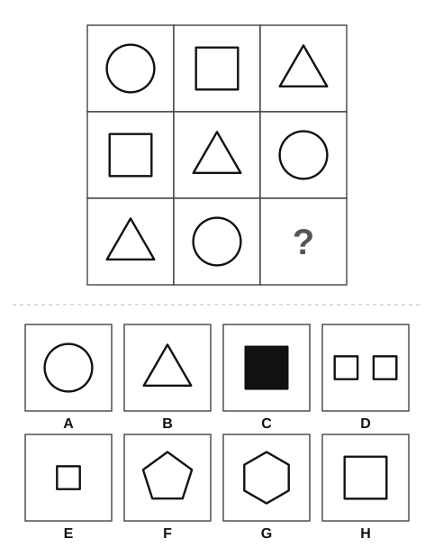
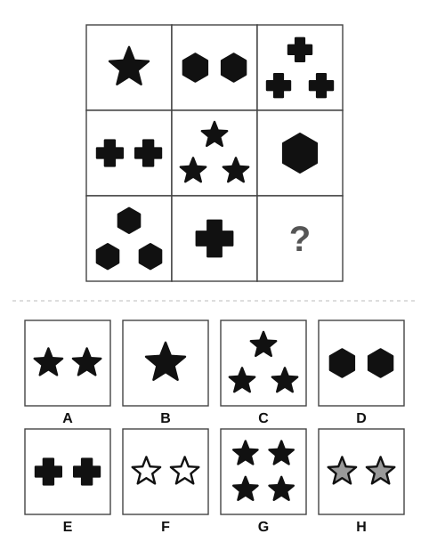
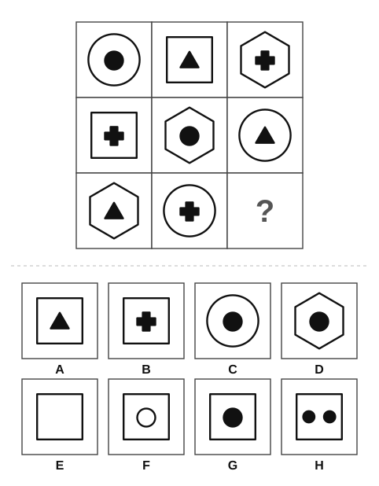
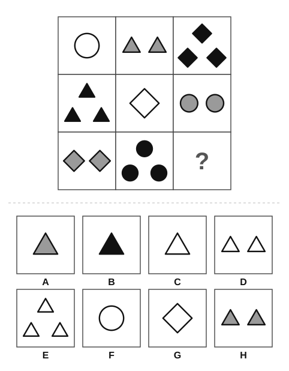
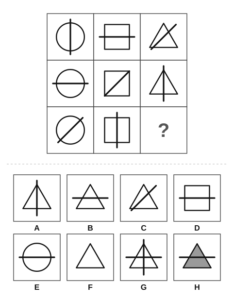
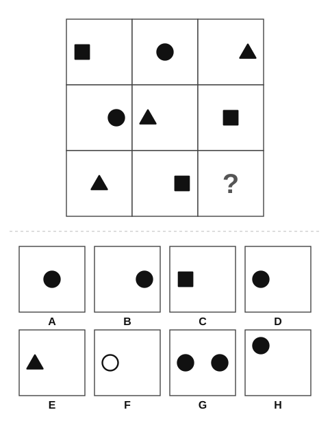
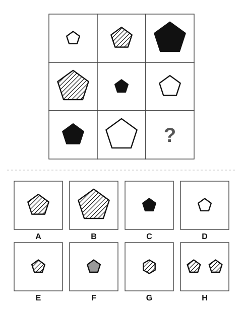
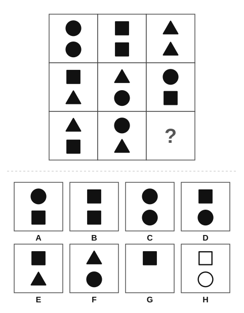

<!-- nav:top -->[Contents](../../README.md#contents) · Previous: [Rotation and movement](rotation.md) · Next: [Addition and subtraction](overlay.md)<!-- /nav:top -->

# Distribution of three

**In one line:** each row contains the same three values, such as a circle, a square and a triangle, once each in a different order, and the gap holds whichever value its row is missing.

This rule is the one people most often fail to see, because nothing "changes" from left to right in a way that looks like a sequence. The values are simply shuffled. Once you know to look for it, it becomes one of the most reliable rules on the test.

## What it measures

Can you notice that a set of values repeats across rows in different arrangements, and work out which one is missing? It is like a Sudoku row with three boxes: each value appears once.

## How the questions look

| Form | What you see | What to check |
|---|---|---|
| One feature | Circle, square, triangle in each row, shuffled | Which shape is missing from the gap's row? |
| Two features | Shapes shuffled one way, shading shuffled another | Solve shape and shading separately |
| Counts | One, two and three of something in each row | Count is the distributed value, not a progression |
| Parts | Outer shape and inner shape each shuffled | Treat outer and inner as two puzzles |
| Positions | Left, centre and right once each | Position is just another value |

A useful tell: if the three values in row 1 also appear in rows 2 and 3, just in a different order, it is almost certainly a distribution of three.

## A method that works

1. **List the values in row 1** for one feature, such as shape: circle, square, triangle.
2. **Check rows 2 and 3 use the same set.** If they do, the rule is distribution.
3. **Write down what row 3 already has,** and cross those values off. The one left is the answer for that feature.
4. **Repeat for every feature that varies:** shading, count, size, position, inner shape.
5. **Combine the answers** into one description: "one white triangle".
6. **Find the option that matches every feature.** Most distractors get one feature right and repeat a value the row already has.

## Traps that cost points

- **Looking for a progression that is not there.** Counts of 1, 2, 3 in row 1 but 2, 3, 1 in row 2 are a distribution, not a sequence.
- **Solving only one feature.** An item can distribute shape, shading and count at once. Each feature needs its own check.
- **Swapping parts.** When a cell has a top and a bottom, or an outer and an inner shape, the swapped version is a common distractor.
- **Being fooled by arrows.** Arrows can be distributed values too. If only three directions ever appear, it is probably distribution, not rotation.
- **Checking columns instead of rows.** Most items distribute along rows, and many along columns as well. If a row check fails, try the columns.

## Timing

Distribution items reward a written or mental tick list. Cross off values row by row and the answer falls out in under a minute, even with three features. If you find yourself searching for a sequence for more than 20 seconds, switch to the distribution check.

## Practice items

These 10 items are original, drawn for these notes. They are not taken from any Raven's test or publisher's materials. Each one is a 3 by 3 matrix with the bottom-right cell missing; choose the option, A to H, that completes it.

<!-- items:start -->

### Item 1

Answer and explanation, item 1

**Answer: H.** Every row holds the same three shapes, a circle, a square and a triangle, each once, in a different order. Row 3 has a triangle and a circle, so the gap is a **white square** of the same size.

*Why not the others:* Option A is a circle, which row 3 already has. Option C is a square but black, and nothing in the grid is shaded.

### Item 2

Answer and explanation, item 2

**Answer: F.** Shape and shading each follow their own distribution of three. Each row has one circle, one square and one triangle, and also one white, one grey and one black shape. Row 3 is missing the square and the white shading: a **white square**.

*Why not the others:* Option A is a square but grey, and row 3 already has a grey shape. Option C is white but a triangle, which row 3 already has.

### Item 3

Answer and explanation, item 3

**Answer: A.** Each row has one, two and three shapes, and also one set of stars, one of hexagons and one of crosses. Row 3 has three hexagons and one cross, so the gap needs the missing count (2) and the missing shape (star): **two black stars**.

*Why not the others:* Option C has three stars, but row 3 already has a cell with three. Option D has two shapes but they are hexagons, already used in row 3.

### Item 4

Answer and explanation, item 4

**Answer: G.** Outer and inner shapes are separate distributions. Each row has a circle, a square and a hexagon outside, and a dot, a triangle and a cross inside. Row 3 is missing the square outside and the dot inside: a **square with a black dot**.

*Why not the others:* Option A pairs the square with a triangle, but row 3 already has an inner triangle. Option C has the dot but in a circle, which row 3 already uses.

### Item 5

Answer and explanation, item 5

**Answer: C.** Three distributions at once: shape (circle, triangle, diamond), shading (white, grey, black) and count (one, two, three). Take them one at a time for row 3. Shapes present: diamond, circle, so the gap is a triangle. Shading present: grey, black, so it is white. Counts present: two, three, so it is one. The answer is **one white triangle**.

*Why not the others:* Option A gets shape and count right but repeats grey. Option D gets shape and shading right but repeats the count of two.

### Item 6

Answer and explanation, item 6

**Answer: B.** The shape is fixed by the column: circles in column 1, squares in column 2, triangles in column 3. The line through the shape follows a distribution of three: vertical, horizontal and sloping, once each per row. Row 3 has a sloping line in column 1 and a vertical line in column 2, so the gap is **a triangle with a horizontal line**.

*Why not the others:* Option A uses the vertical line, already in row 3. Option D has the horizontal line but in a square, and column 3 is all triangles.

### Item 7

Answer and explanation, item 7

**Answer: D.** Each row uses a square, a circle and a triangle once, and puts the shape on the left, in the centre and on the right once each. Row 3 has a triangle in the centre and a square on the right, so the gap is a **black circle on the left**.

*Why not the others:* Option A is a circle but in the centre, a position row 3 already uses. Option C is on the left but a square, already in row 3.

### Item 8

Answer and explanation, item 8

**Answer: E.** All the shapes are pentagons, so look at what changes: size and fill. Each row has one small, one medium and one large pentagon, and one white, one striped and one black. Row 3 has a large black one and a medium white one, so the gap is a **small striped pentagon**.

*Why not the others:* Option A is striped but medium, a size row 3 already has. Option C is small but black, a fill row 3 already has.

### Item 9

Answer and explanation, item 9

**Answer: A.** This is not a rotation item, even though it uses arrows. The arrows only ever point up, right or down, and each row has each direction once. Shading is also a distribution: white, black and grey once per row. Row 3 has down-grey and up-black, so the gap is a **white arrow pointing right**.

*Why not the others:* Option F points left, a direction that never appears in the grid, which is a sign a turning rule is the wrong idea here. Option B points right but is black, already in row 3.

### Item 10

Answer and explanation, item 10

**Answer: D.** Each cell has a top shape and a bottom shape, and each follows its own distribution of circle, square and triangle. Row 3 tops: triangle, circle, so the top of the gap is a square. Row 3 bottoms: square, triangle, so the bottom is a circle. The answer is a **square above a circle**.

*Why not the others:* Option A has the right two shapes but the wrong way round. That swap is the most common miss on two-part cells: solve the top and the bottom separately, then check both.

<!-- items:end -->

## Score yourself

<!-- key:start -->

| Item | 1 | 2 | 3 | 4 | 5 | 6 | 7 | 8 | 9 | 10 |
|---|---|---|---|---|---|---|---|---|---|---|
| Answer | H | F | A | G | C | B | D | E | A | D |

<!-- key:end -->

- **9 to 10:** you spot shuffled sets quickly. Move on to [addition and subtraction](overlay.md).
- **6 to 8:** look for misses where one feature was right and another repeated a value. Add a final "does this repeat anything in the row?" check.
- **5 or fewer:** practise listing the values of row 1 before doing anything else. Most misses here come from not testing for distribution at all.

## Next step

In a real test, distribution is mixed in with every other rule. Practise switching between them with the [free Raven's practice test on PrepClubs](https://prepclubs.com/free-practice-tests/ravens-progressive-matrices?utm_source=github&utm_medium=referral&utm_campaign=study-notes&utm_content=ravens-progressive-matrices).

---

<!-- nav:bottom -->← Previous: [Rotation and movement](rotation.md) | Next: [Addition and subtraction](overlay.md) → | [Back to contents](../../README.md#contents)<!-- /nav:bottom -->
