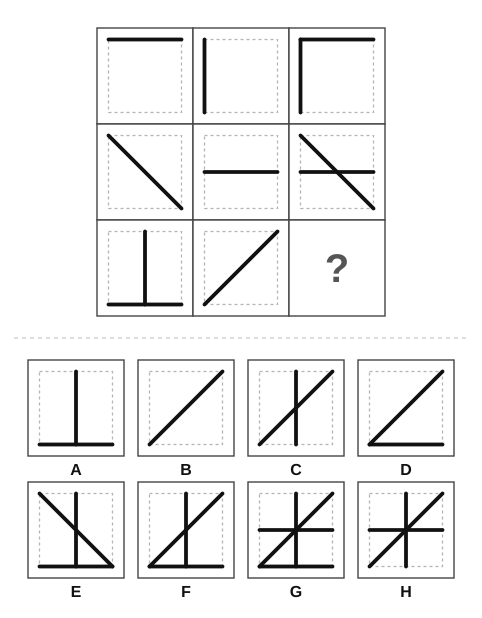
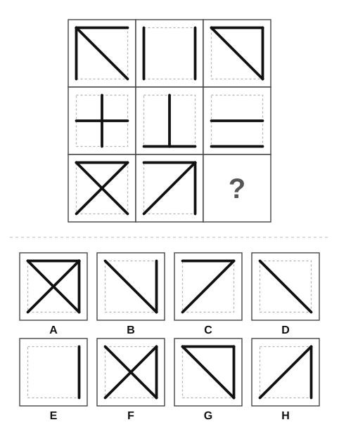
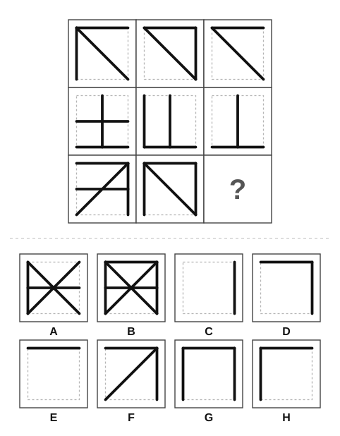
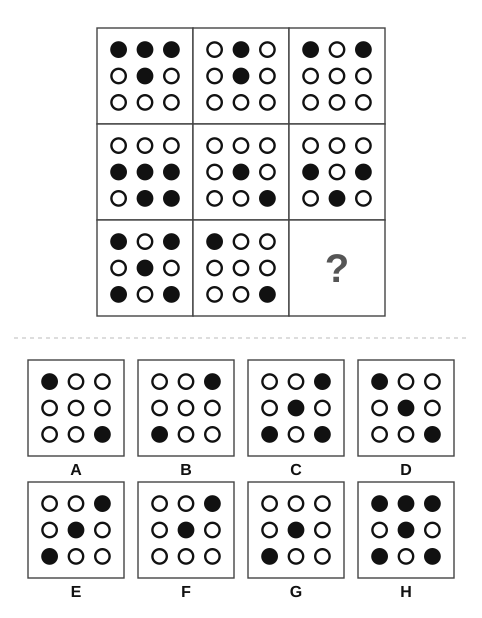
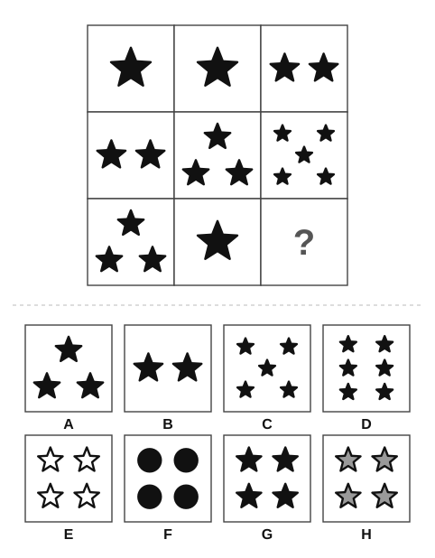
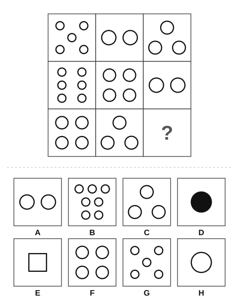
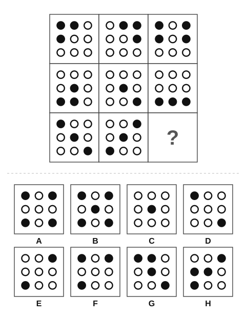
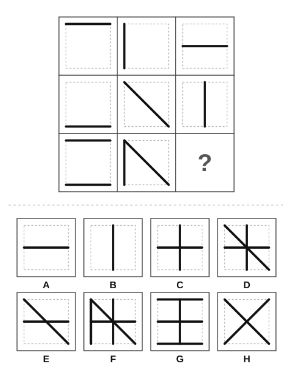
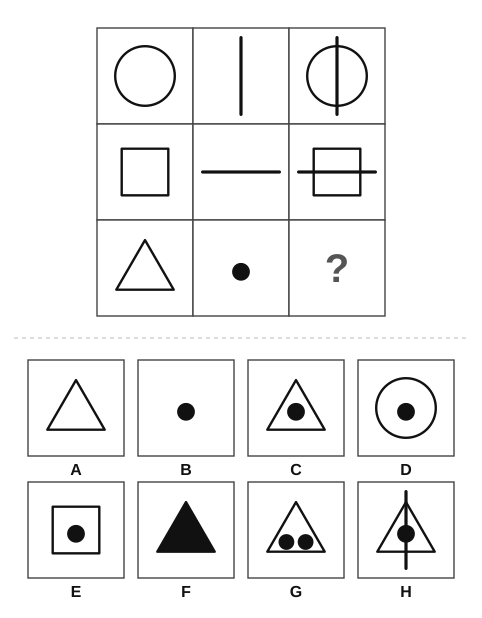
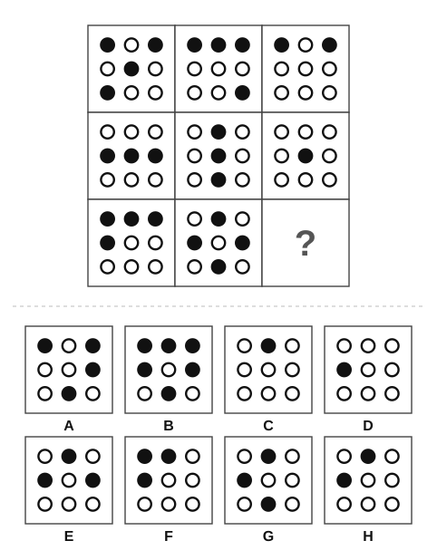

<!-- nav:top -->[Contents](../../README.md#contents) · Previous: [Distribution of three](distribution.md) · Next: [Combined rules](combined.md)<!-- /nav:top -->

# Addition and subtraction

**In one line:** the third cell is built from the first two, by laying them on top of each other, by keeping only what they share, by cancelling what they share, or by taking one away from the other.

These items look busy, with lines and dots everywhere, but they follow a small set of exact rules. Learn the four variants and check every element against them, and they become some of the most dependable points on the test.

## What it measures

Can you compare two pictures element by element and combine them by a fixed rule? It is set logic in pictures: union, intersection, difference.

## How the questions look

The four variants, in the order they are usually easiest to spot:

| Variant | Rule for cell 3 | Tell-tale sign in row 1 |
|---|---|---|
| Add (overlay) | Everything in cell 1 plus everything in cell 2 | Cell 3 is the busiest cell |
| Keep shared | Only elements in both cell 1 and cell 2 | Cell 3 is the emptiest cell |
| Cancel shared | Elements in one cell but not both | Something in both cells is missing from cell 3 |
| Subtract | Cell 1 with cell 2's elements removed | Cell 2 is a part of cell 1 |

Counts work the same way: cell 3 can hold the sum or the difference of the first two counts.

Most items run along the rows. Some run down the columns instead. If row 1 does not combine into anything, test the columns.

## A method that works

1. **Pick one element in row 1,** say the top edge or the centre dot.
2. **Ask where it appears:** cell 1 only, cell 2 only, both, or neither. Then check whether it is in cell 3.
3. **Do this for three or four elements** until the rule is clear. "Shared ones vanish" or "everything is kept".
4. **Confirm on row 2.** One clean confirmation is enough.
5. **Build the answer for row 3 element by element.** List each line or dot that should be in the gap.
6. **Match the full list** to an option. Distractors usually apply the wrong variant, so the wrong options look like real combinations.

## Traps that cost points

- **Assuming plain addition.** Overlay is the first idea most people have. Always check what happens to elements that appear in both cells.
- **Checking only the obvious elements.** One missing edge or one extra diagonal is the whole difference between options. Check every element.
- **Confusing the diagonals.** Name them: "top left to bottom right" and "top right to bottom left".
- **Picking the removed part.** In subtraction items, one option shows exactly what was taken away. That is the opposite of the answer.
- **Not trying the columns.** If the rows do not combine, the columns probably do.

## Timing

Overlay items can take longer because there are more elements to check. Budget up to one and a half minutes on a hard one on APM-III. The element-by-element check is quicker than it sounds once you are used to it, and it avoids the most common errors.

## Practice items

These 10 items are original, drawn for these notes. They are not taken from any Raven's test or publisher's materials. Each one is a 3 by 3 matrix with the bottom-right cell missing; choose the option, A to H, that completes it. In the dot items, every cell shows nine positions: black means a dot is there, white means it is empty. In the line items, the faint dashed square is only a guide; the thick lines are the elements.

<!-- items:start -->

### Item 1

Answer and explanation, item 1

**Answer: F.** The third cell in each row is the first two laid on top of each other. Row 3 combines the vertical middle line and the bottom edge with the diagonal from top right to bottom left: **all three lines together**.

*Why not the others:* Option C drops the bottom edge. Option E uses the other diagonal. With overlay items, check every line in the answer against the two source cells.

### Item 2

Answer and explanation, item 2

**Answer: B.** Lines that appear in both of the first two cells cancel out; lines that appear in only one of them are kept. Check row 1: the left edge is in both and is gone from cell 3. In row 3, the top edge and the diagonal from top right are shared, so they cancel. What is left is **the diagonal from top left and the right edge**.

*Why not the others:* Option A keeps every line, which is plain addition and does not fit row 1. Option C keeps only the shared lines, the opposite rule.

### Item 3

Answer and explanation, item 3

**Answer: D.** Only the lines that the first two cells **share** survive into the third. In row 3, the two cells share the right edge and the top edge, so the gap shows **the top and right edges only**.

*Why not the others:* Option A keeps the lines that are not shared, which is the opposite rule. Option F adds a diagonal that only the first cell has.

### Item 4

Answer and explanation, item 4

**Answer: E.** Each cell is a 3 by 3 grid of positions. The third cell is the first cell **minus** the dots shown in the second. In row 3, the first cell has an X of five dots and the second has the top-left and bottom-right dots, so remove those two: the answer is **the other diagonal, top right, centre and bottom left**.

*Why not the others:* Option B removes the centre too. Option A is the dots that were removed, not the ones that are left.

### Item 5

Answer and explanation, item 5

**Answer: G.** Count the stars. The third cell in each row holds as many stars as the first two together: 1 + 1 = 2, 2 + 3 = 5. Row 3 has 3 and 1, so the gap holds **four black stars**.

*Why not the others:* Option A has three, which copies the first cell. Option C has five, which only fits if you assume the third cell copies row 2.

### Item 6

Answer and explanation, item 6

**Answer: H.** The third cell holds the first cell's count **minus** the second's: 5 - 2 = 3, 6 - 4 = 2. Row 3 has 4 and 3, so the gap holds **one white circle**.

*Why not the others:* Option B has seven, which adds instead of subtracting. Always test whether row 1 adds or subtracts before you use it.

### Item 7

Answer and explanation, item 7

**Answer: A.** A dot that appears in both of the first two cells disappears; a dot in only one of them stays. In row 1, the shared top-middle dot is gone. In row 3, both cells share the centre dot, so it cancels and the four corners stay: **a dot in each corner, centre empty**.

*Why not the others:* Option B keeps the centre, which is plain addition. Option C keeps only the centre, which is the shared part.

### Item 8

Answer and explanation, item 8

**Answer: C.** This one works **down the columns**, not along the rows. Row 1 does not combine into anything, so test the columns: in column 1, the top edge (row 1) and the bottom edge (row 2) together give row 3. Column 3 has the horizontal middle line and the vertical middle line, so the gap is **a plus sign, both middle lines**.

*Why not the others:* Option A and Option B each keep only one of the two lines. If a row rule fails on row 1, always try the columns before guessing.

### Item 9

Answer and explanation, item 9

**Answer: C.** The third cell is simply the first two drawn on top of each other: circle plus line, square plus line. Row 3 gives **a white triangle with a black dot in the middle**.

*Why not the others:* Option A is the triangle alone and Option B is the dot alone: each copies one source cell. A warm-up item, but the same check applies to the hardest overlays.

### Item 10

Answer and explanation, item 10

**Answer: H.** Only dots that appear in **both** of the first two cells survive. Row 2 shows it clearly: a horizontal line and a vertical line share only the centre. In row 3, the cells share the top-middle and middle-left dots, so the answer is **those two dots only**.

*Why not the others:* Option A keeps the unshared dots instead. Option C keeps only one of the two shared dots.

<!-- items:end -->

## Score yourself

<!-- key:start -->

| Item | 1 | 2 | 3 | 4 | 5 | 6 | 7 | 8 | 9 | 10 |
|---|---|---|---|---|---|---|---|---|---|---|
| Answer | F | B | D | E | G | H | A | C | C | H |

<!-- key:end -->

- **9 to 10:** you can tell the four variants apart. Move on to [combined rules](combined.md).
- **6 to 8:** your misses are probably wrong-variant errors. Before each item, test the shared elements first.
- **5 or fewer:** go back to the table of variants and, for every practice item, write which variant it is before you build the answer.

## Next step

Overlay items are where careful checking pays off most. Test your accuracy at speed with the [free Raven's practice test on PrepClubs](https://prepclubs.com/free-practice-tests/ravens-progressive-matrices?utm_source=github&utm_medium=referral&utm_campaign=study-notes&utm_content=ravens-progressive-matrices).

---

<!-- nav:bottom -->← Previous: [Distribution of three](distribution.md) | Next: [Combined rules](combined.md) → | [Back to contents](../../README.md#contents)<!-- /nav:bottom -->
