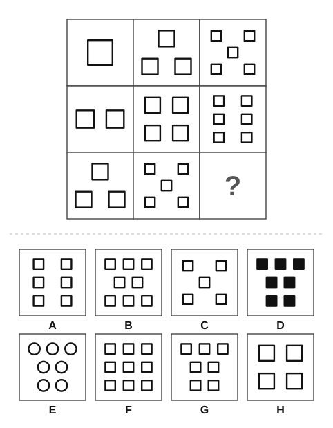
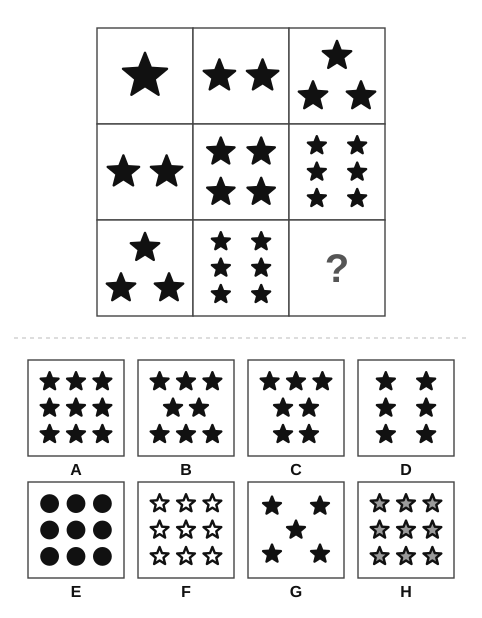

<!-- nav:top -->
[Contents](../../README.md#contents) · Previous: [15-minute diagnostic](../diagnostic.md) · Next: [Rotation and movement](rotation.md)
<!-- /nav:top -->

# Progression

**In one line:** something changes by the same step from cell to cell, and you continue the step into the gap.

Progression is the first rule to test on any Raven's item, because it is the most common and the quickest to check. A number of shapes goes up by one. A shape gets bigger. A polygon gains a side. The hard part is not seeing that something changes; it is reading the exact size of the step.

## What it measures

Can you see a quantity changing in a regular way and predict the next value? It is the visual version of a number sequence: 2, 4, 6, and then 8. The quantities on Raven's style items are things you can count or compare:

- the **number** of shapes in a cell
- the **size** of a shape
- the **number of sides** of a polygon
- the **shading**, from light to dark
- the **position** of a shape, step by step across the cell

## How the questions look

A 3 by 3 grid where each row (and often each column) shows a value climbing or falling. Typical forms:

| Form | What you see | What to check |
|---|---|---|
| Count | 1, 2, 3 dots across a row | Is the step one, two, or something else? |
| Size | Small, medium, large | Does the shape stay the same while the size grows? |
| Sides | Triangle, square, pentagon | Count the sides, do not trust your eye |
| Shading | White, grey, black | Is shading the only change, or one of two? |
| Two directions | Count rises across rows and down columns | Read both steps separately |

Often the row sets one thing and the column sets another. In a grid where the count climbs across each row and each row starts one higher, the bottom-right cell is the largest value in the grid.

## A method that works

1. **Take one complete row.** Usually row 1. Ignore the gap for now.
2. **List what changes between cell 1 and cell 2,** then between cell 2 and cell 3. Count, size, sides, shading, position. One feature at a time.
3. **Measure the step.** Write it down as a number if you can: "+1 dot", "+2 squares", "+1 side".
4. **Check the step on row 2.** If it holds, you have the rule. If row 2 starts from a different value, note how the start changes from row to row.
5. **Apply it to row 3** and predict the gap in words before you look at the options: "five black dots".
6. **Find your prediction among the options,** then check that nothing else about it is different: same shape, same shading, same size.

## Traps that cost points

- **Assuming a step of one.** Many items step by two or by an amount that grows. Always measure the step on a complete row.
- **Counting by eye.** A hexagon and a heptagon look alike at a glance. So do six and seven dots. Count every time.
- **Copying the previous cell.** The option that repeats the cell to the left of the gap is a standard distractor.
- **Fixing one feature and breaking another.** The option with the right count but the wrong shading or shape is always there. Check every feature, not just the one that changes.
- **Ignoring the column.** If the row gives you a step but the numbers do not fit row 3, the column may set the start value.

## Timing

Progression items are usually the quickest on the test. On APM-III, 40 minutes for 23 items is about one minute 45 seconds each, so aim to clear progression items in under a minute and bank the time for harder items. On the untimed Raven's Adaptive, accuracy matters more than speed, but there is no reason to linger once you have checked your answer against two rows.

## Practice items

These 2 items are original, drawn for these notes. They are not taken from any Raven's test or publisher's materials. Each one is a 3 by 3 matrix with the bottom-right cell missing; choose the option, A to H, that completes it. Commit to an answer before you open the explanation.

<!-- items:start -->

### Item 1

Answer and explanation, item 1

**Answer: G.** The count rises by **two** across each row: 1, 3, 5 in row 1, then 2, 4, 6, then 3, 5 and the gap. Add two to 5: **7 white squares**.

*Why not the others:* Option A has 6, which is what you get if you assume the step is one. Option B has 8. Always check the step size on a complete row before you trust it.

### Item 2

Answer and explanation, item 2

**Answer: A.** Column 1 counts 1, 2, 3. Each row then goes up in steps of its first number: row 1 in ones (1, 2, 3), row 2 in twos (2, 4, 6), row 3 in threes (3, 6, and the gap). That gives **9 black stars**.

*Why not the others:* Option B has 8 and Option C has 7: both come from guessing a fixed step instead of reading the step from the row's first cell.

<!-- items:end -->

Want more? The [free timed Raven's practice test on PrepClubs](https://prepclubs.com/free-practice-tests/ravens-progressive-matrices?utm_source=github&utm_medium=referral&utm_campaign=7acab2&utm_content=ravens-progressive-matrices) has the full 23 puzzles, every answer explained.

## Score yourself

<!-- key:start -->

| Item | 1 | 2 |
|---|---|---|
| Answer | G | A |

<!-- key:end -->

- **2 of 2:** your counting is careful and your step reading is sound. Move on to [rotation](rotation.md).
- **1 of 2:** look at the misses. If you chose a copy of the previous cell or a step of one, slow down at step 3 of the method.
- **0 of 2:** go back to the method and say the step out loud ("plus two") for every row before you look at the options.

## Next step

Progression is easy in isolation and costly under time pressure. Try it inside a full timed set with the [free Raven's practice test on PrepClubs](https://prepclubs.com/free-practice-tests/ravens-progressive-matrices?utm_source=github&utm_medium=referral&utm_campaign=7acab2&utm_content=ravens-progressive-matrices).

---

<!-- nav:bottom -->
← Previous: [15-minute diagnostic](../diagnostic.md) | Next: [Rotation and movement](rotation.md) → | [Back to contents](../../README.md#contents)
<!-- /nav:bottom -->
