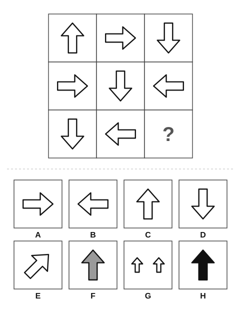
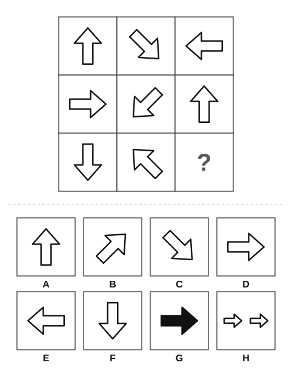

<!-- nav:top -->[Contents](../../README.md#contents) · Previous: [Progression](progression.md) · Next: [Distribution of three](distribution.md)<!-- /nav:top -->

# Rotation and movement

**In one line:** a shape turns by a fixed angle, or travels round the cell by a fixed step, and you continue the turn or the journey into the gap.

Rotation items look easy and catch a lot of people, because the eye judges angles badly and "clockwise" is easy to flip under pressure. The fix is mechanical: name the direction in each cell as a word, then work with the words.

## What it measures

Can you track how something turns or moves, keep the direction straight, and predict where it ends up? In real terms, it is the same skill as following a route on a map or reading a dial.

## How the questions look

| Form | What you see | What to check |
|---|---|---|
| Quarter turns | An arrow pointing up, right, down | Clockwise or anticlockwise? |
| Eighth turns | A line or arrow stepping 45 degrees | Is it 45, 90 or 135 degrees each time? |
| Moving element | A dot moving from corner to corner | Which way round, and how many corners per step? |
| Wrap-around | A filled slot moving left to right, then back to the start | Where does it go after the last position? |
| Two movers | Two dots or arrows moving in opposite directions | Track each one on its own |

A line looks the same after half a turn, and a square looks the same after a quarter turn. When a shape is symmetrical, its rotation can "come back round" sooner than you expect.

## A method that works

1. **Name each cell in words.** "Up, right, down." "Top left, top right, bottom right." Do not try to rotate shapes in your head yet.
2. **Find the step between two neighbours.** Up to right is a quarter turn clockwise. Top left to top right is one corner clockwise.
3. **Confirm the step on a second pair.** If row 1 says clockwise and row 2 agrees, trust it.
4. **Check how each row starts.** Rows often start at different angles. The rule usually lives inside the row; the starts may have their own small step.
5. **Apply the step to the last filled cell** and say the answer in words: "pointing left".
6. **Match the words to an option,** and check fill, size and count too.

## Traps that cost points

- **Flipping the direction.** The option that turns the right amount the wrong way is always there. Check clockwise against a clock face: twelve, three, six, nine.
- **Using the row step inside the row.** If rows start 45 degrees apart but turn 90 degrees inside each row, mixing the two gives the wrong answer.
- **Forgetting the wrap.** After the last corner or slot, the next position is the first one again.
- **Assuming 90 degrees.** Measure the actual angle on row 1. A 135 degree step is perfectly possible.
- **Solving two movers together.** When there are two moving parts, solve one, then the other. Swapped colours are a classic distractor.

## Timing

Once the directions are named in words, most rotation items take under a minute. If you notice yourself turning the page (or your head) to imagine a shape, stop and go back to step 1. Naming is faster than visualising.

## Practice items

These 2 items are original, drawn for these notes. They are not taken from any Raven's test or publisher's materials. Each one is a 3 by 3 matrix with the bottom-right cell missing; choose the option, A to H, that completes it.

<!-- items:start -->

### Item 1

Answer and explanation, item 1

**Answer: C.** The arrow turns a quarter turn (90 degrees) clockwise with each step to the right. Each row starts a quarter turn on from the row above. Row 3 points down, then left, so next it points **up**.

*Why not the others:* Option A points right, which is a quarter turn too far. Option B points left, the same as the cell before the gap, which means no turn at all.

### Item 2

Answer and explanation, item 2

**Answer: D.** The arrow turns 135 degrees clockwise (a quarter turn plus an eighth) with each step to the right. Check it on row 1: up, then down-right, then left. Row 3 starts down, then up-left, so add 135 degrees once more: it points **right**.

*Why not the others:* Option C points down-right, the result of a 90 degree step. When a quarter turn does not fit row 1, measure the actual angle between two cells instead of assuming.

<!-- items:end -->

Want more? The [free timed Raven's practice test on PrepClubs](https://prepclubs.com/free-practice-tests/ravens-progressive-matrices?utm_source=github&utm_medium=referral&utm_campaign=study-notes&utm_content=ravens-progressive-matrices) has the full 23 puzzles, every answer explained.

## Score yourself

<!-- key:start -->

| Item | 1 | 2 |
|---|---|---|
| Answer | C | D |

<!-- key:end -->

- **2 of 2:** your direction tracking is reliable. Move on to [distribution of three](distribution.md).
- **1 of 2:** check whether your misses were direction flips or step-size errors, and add one check to your routine for that.
- **0 of 2:** write the direction words under each cell on paper for the next ten items you practise, until it becomes automatic.

## Next step

Rotation gets harder when it is mixed with other rules. Test yourself on mixed items in the [free Raven's practice test on PrepClubs](https://prepclubs.com/free-practice-tests/ravens-progressive-matrices?utm_source=github&utm_medium=referral&utm_campaign=study-notes&utm_content=ravens-progressive-matrices).

---

<!-- nav:bottom -->← Previous: [Progression](progression.md) | Next: [Distribution of three](distribution.md) → | [Back to contents](../../README.md#contents)<!-- /nav:bottom -->
