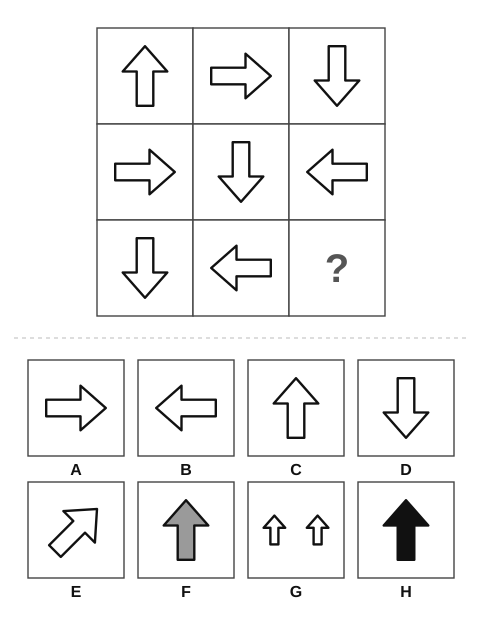

<!-- nav:top -->
[Contents](../README.md#contents) · Next: [15-minute diagnostic](diagnostic.md)
<!-- /nav:top -->

# Raven's Progressive Matrices explained

Raven's Progressive Matrices is a non-verbal reasoning test. Every question is a pattern of shapes with one piece missing, and you pick the piece that completes it. There are no words to read and no maths to do, which is why employers use it to compare people from different countries and backgrounds. Pearson TalentLens publishes the versions used in hiring.

## Quick facts

| | Raven's Adaptive | Raven's APM-III | Classic APM (paper) |
|---|---|---|---|
| Where you meet it | Online job assessments | Online job assessments, often for graduate and manager roles | Clinical, school and research settings, some supervised hiring |
| Questions | 15 | 23, after 4 practice items | Sets 1 and 2 (count not stated on the store page) |
| Time | About 12 minutes, untimed | 40 minutes maximum | Untimed, usually 40 to 60 minutes |
| Format | 3 by 3 design, one piece missing, 8 options | Incomplete matrix or series, 8 options | Paper booklet, hand scored |
| How questions are chosen | Adaptive: harder after a right answer, easier after a wrong one | Drawn at random from an item bank | Fixed booklet |
| Result | Percentile against a norm group | Percentile against a norm group | Raw score and percentile |

Sources: [Raven's Adaptive](https://www.talentlens.com/raven-adaptive.html), [APM-III FAQ](https://www.talentlens.com/content/dam/school/global/Global-Talentlens/fr/documents-solutions/DOCUMENTS-RAVEN/TALENTLENS_TLO_APM_III_FAQ_v022019.pdf) and [Pearson's APM page](https://www.pearsonassessments.com/store/en/usd/p/100000414.html), checked 24 November 2026.

## Which version will I get?

Your invitation or the testing platform usually names it. If it says "15 questions" or "adaptive", it is Raven's Adaptive. If it says "23 questions" and "40 minutes", it is APM-III. If it is on paper with a booklet, it is the classic APM or Raven's 2. The skill is the same in all of them, so the preparation is the same too.

TalentLens says APM-III is aimed at graduate, manager and senior roles, and suggests a different abstract reasoning test for non-managerial roles. Raven's Adaptive is described as suitable for a wide range of ability levels, because each candidate gets items pitched at their level.

## What the test measures

TalentLens describes Raven's as a measure of fluid intelligence: spotting relationships and patterns in information you have not seen before, without relying on what you already know. In its own words, it looks at lateral thinking, learning new concepts quickly and solving new problems.

In practice, that means one thing: **finding the rule that links the cells of a grid, and applying it to the gap.**

## How a question looks

Each question is a grid, usually 3 by 3, with the bottom-right cell empty. Below it are eight possible answers. Here is one of the original practice items from this repo:

The arrow turns a quarter turn clockwise at each step along a row, so the gap is an arrow pointing up. That item is explained in full in the [rotation guide](sections/rotation.md).

## The five kinds of rule

Raven's does not have named sections. Every item is a matrix. But the rules behind the items fall into a handful of families, and learning to spot each family is the fastest way to improve. These notes split them into five guides:

| Rule family | What changes | Guide |
|---|---|---|
| Progression | Something grows, shrinks or counts up step by step | [Progression](sections/progression.md) |
| Rotation and movement | Something turns or travels around the cell | [Rotation and movement](sections/rotation.md) |
| Distribution of three | Each row holds the same three things in a different order | [Distribution of three](sections/distribution.md) |
| Addition and subtraction | The third cell is the first two combined, cancelled or subtracted | [Addition and subtraction](sections/overlay.md) |
| Combined rules | Two or three of the above at once | [Combined rules](sections/combined.md) |

These names are ours, chosen to be easy to remember. Researchers and prep sites use similar groupings; the publisher does not publish a list of rule types.

## Why employers use it

TalentLens gives three reasons on its product pages: the questions are diagrammatic, so language and culture matter less; the test predicts how quickly people learn and solve new problems; and the adaptive version gives a reliable score in a short time. It is used in graduate recruitment and across sectors. See the [job applicants guide](job-applicants.md) for what this means for you.

## Practise the real format

The notes teach the rules. A timed run teaches the pace. Try the [free Raven's Matrices practice test on PrepClubs](https://prepclubs.com/free-practice-tests/ravens-progressive-matrices?utm_source=github&utm_medium=referral&utm_campaign=study-notes&utm_content=ravens-progressive-matrices), 23 puzzles in the APM-III style, then come back to the guide for any rule family that cost you points.

---

<!-- nav:bottom -->
Next: [15-minute diagnostic](diagnostic.md) → | [Back to contents](../README.md#contents)
<!-- /nav:bottom -->
